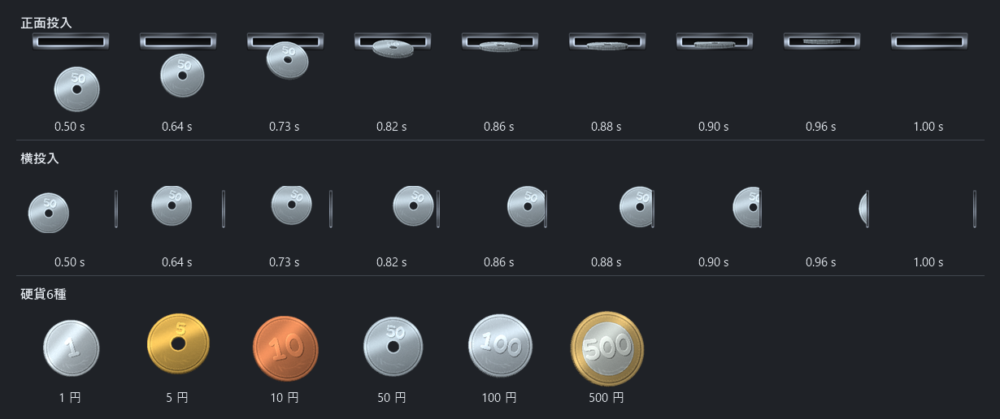

# コイン投入演出

AviUtl2 のメディアオブジェクトです。自動販売機、券売機、ゲーム機などの映像に、硬貨を入れる動きを重ねられます。硬貨は日本円の通常貨幣6種から選べます。

## インストール

動作環境は Windows 64-bit 版の AviUtl2 2.1.16 以降です。

1. AviUtl2 を終了し、配布 ZIP を展開します。[v1.0.0 の配布 ZIP](https://github.com/vramwiz/SYNC_CoinInsert/releases/download/v1.0.0/SYNC_CoinInsert.zip)
2. 展開した `SYNC_CoinInsert` フォルダーを `C:\ProgramData\aviutl2\Plugin\` にコピーし、AviUtl2 を起動します。

更新時は同じ場所に新しいフォルダーを上書きします。アンインストールするには AviUtl2 を終了し、配置した `SYNC_CoinInsert` フォルダーを削除します。

## 使い方

1. AviUtl2 2.1.16 以降のタイムラインに、メディアオブジェクトの「SYNC」から「コイン投入演出」を追加します。
2. 標準の描画項目で、投入口の中心を素材の投入口に合わせます。位置・拡大率・回転・透明度は標準項目で調整できます。
3. 素材の投入口を使う場合は「金属枠表示」をオフにします。硬貨はその位置に入って消えます。

初期設定は 100 円、50 円、10 円の順です。最後の硬貨の投入まで表示するには、オブジェクトを約 2.4 秒以上に伸ばしてください。

## 設定

| パラメータ | 初期値 | 調整内容 |
| --- | --- | --- |
| 投入方向 | 正面 | 手前から奥へ入れる「正面」と、画面の左から入れる「横」 |
| コイン指定 | `100,50,10` | 1、5、10、50、100、500円をカンマ区切りで左から指定。同じ額面も繰り返し指定可 |
| コイン拡大率 | 100% | 硬貨だけを 10～300% で拡大・縮小 |
| 投入距離 | 100 | 正面での硬貨の初期位置。0～300 の範囲で、投入時間は一定 |
| 金属枠表示 | オン | 投入口の描画の有無 |
| 投入開始までの時間 | 0.50 秒 | オブジェクト先頭から 1 枚目が現れるまでの時間 |
| 1枚あたりの投入時間 | 0.50 秒 | 硬貨が現れてから投入口に入るまでの時間 |
| 投入間隔 | 0.70 秒 | 硬貨が現れてから次の硬貨が現れるまでの時間。投入時間より短い設定では動きが重なる |
| 横投入の下降 | スムーズ | 頂点から投入完了まで滑らかに下降。「一時停止」を選ぶと、投入口に差しかかったところで上下の動きが止まる |

時間は 0.01 秒単位で調整できます。硬貨指定の空欄・未対応の値は読み飛ばします。数字とカンマは全角でも入力できます。

## ライセンス

本体は GPL-3.0-only です。[ライセンス全文](LICENSE) · [共通基盤のライセンス表示](THIRD_PARTY_NOTICES.md)
